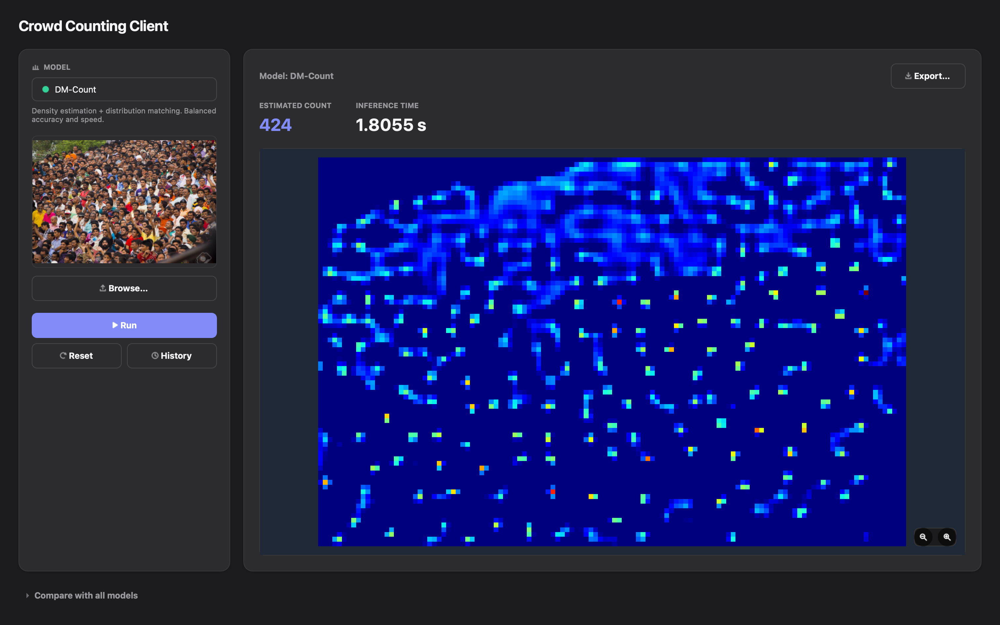
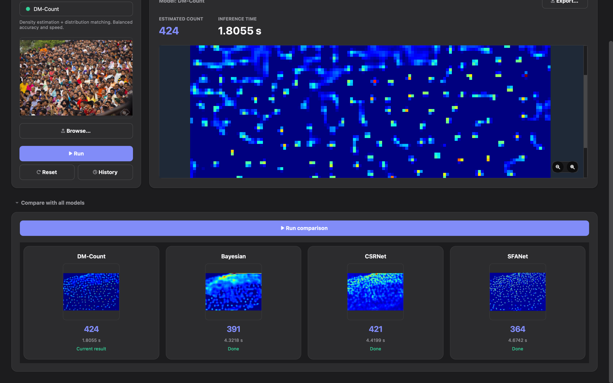

# Crowd Counting Model Comparison

Estimate how many people are in an image, and compare four pretrained
deep-learning crowd-counting models (DM-Count, Bayesian, CSRNet and SFANet)
on accuracy and speed.

This repository contains four small FastAPI services (one per model), a
benchmark on 50 ShanghaiTech images, and a PyQt5 desktop app where you can
drop in an image, run any model, or run all four side by side. It started as
a bachelor project. None of the models are trained here: the project
integrates, serves, benchmarks and compares existing pretrained weights.

## Screenshots





## What is in this repository

- **Four pretrained models** (DM-Count, Bayesian, CSRNet, SFANet), served
  through the [LWCC](https://github.com/tersekmatija/lwcc) library behind an
  identical FastAPI interface.
- **A benchmark** that runs all four models on 50 ShanghaiTech test images
  (25 from Part A, 25 from Part B) with known ground-truth counts, and
  reports MAE, RMSE, MAPE and inference time.
- **A desktop app** (PyQt5) to run one model or all four, view the predicted
  density map, keep a history of runs and export results.

## What is NOT included

- **The ShanghaiTech dataset and the 50 selected images.** See
  [Dataset](#dataset-not-included). Only the benchmark results are included.
- **Virtual environments** (`.venv`). Create them as described below.
- **Model weights.** LWCC downloads them on first use (internet required).

## Repository layout

```text
crowd-counting-model-comparison/
├── DMcount-counting-api 2/      # FastAPI service: DM-Count    (port 8001)
├── bayesian-counting-api 2/     # FastAPI service: Bayesian    (port 8002)
├── csrnet-counting-api 2/       # FastAPI service: CSRNet      (port 8003)
├── sfanet-counting-api 2/       # FastAPI service: SFANet      (port 8004)
├── crowd-counting-benchmark/    # Benchmark scripts and results
├── crowd-counting-ui/           # PyQt5 desktop app
└── docs/images/                 # Screenshots used in this README
```

> The four service folders keep the `" 2"` suffix in their names, and the
> desktop app's `config.py` and the benchmark scripts refer to those exact
> names. If you rename them, point the app to the new names with the
> environment variables listed in section 4.2.

Each service folder has the same layout:

```text
<model>-counting-api 2/
├── app/
│   ├── config.py            # model name/weights, upload limits, paths
│   ├── <model>_service.py   # loads the LWCC model, runs inference, saves the density map
│   └── main.py              # FastAPI app: GET /, GET /model-info, POST /predict
├── scripts/fix_lwcc_path.py # macOS fix for an LWCC weights-path problem (bayesian/csrnet/sfanet)
├── tests/                   # pytest suite (inference is mocked)
├── requirements.txt
└── README.md                # a more detailed README for this service
```

The benchmark folder contains:

```text
crowd-counting-benchmark/
├── scripts/
│   ├── select_shanghaitech_final.py  # picked the 50-image sample from the dataset
│   ├── run_benchmark_final.py        # runs all 4 models on the sample
│   ├── benchmark_worker.py           # per-model worker (runs inside each service's own venv)
│   └── generate_final_results.py     # builds summaries and charts
├── ground_truth_final.csv            # the list of the 50 images used in the final run
├── results_final/                    # the numbers quoted below come from here
│   ├── final_results_summary.md
│   ├── benchmark_results.csv         # one row per (model, image, repeat)
│   ├── summary_by_model*.csv
│   └── charts/*.png
├── report_examples/                  # ground truth vs. each model's prediction for 4 sample images
└── ground_truth.csv, results/        # an earlier, smaller 5+5-image pilot run
```

## 1. How each API service works

All four services expose the **same three endpoints** and the same JSON
shape. Only the model, its weights and its training dataset differ.

| Endpoint | Method | What it does |
|---|---|---|
| `/` | GET | Health check: `{"message": "...API is running.", "docs": "/docs"}` |
| `/model-info` | GET | Model name, weights, training dataset, method and task |
| `/predict` | POST | Accepts an image (multipart `file`) and returns the prediction below |

A `/predict` request validates that the upload is a real image (Pillow) and at
most 10 MB, saves it to a temporary file, runs inference in a thread pool on a
model that is loaded once and reused, saves the density map as a PNG, deletes
the temporary upload and returns:

```json
{
  "original_filename": "crowd.jpg",
  "model": "DM-Count",
  "model_weights": "SHA",
  "training_dataset": "ShanghaiTech Part A (SHA)",
  "method": "Density Estimation + Distribution Matching",
  "task": "Crowd Counting",
  "estimated_count": 261.665,
  "rounded_count": 262,
  "density_map_shape": [82, 124],
  "density_map_url": "/outputs/density_maps/dmcount_density_<uuid>.png",
  "inference_time_seconds": 1.2345
}
```

The density map is served at `density_map_url`.

| Model | LWCC name | Weights | Training data | Method |
|---|---|---|---|---|
| DM-Count | `DM-Count` | SHA | ShanghaiTech Part A | Density estimation + distribution matching |
| Bayesian | `Bay` | SHA | ShanghaiTech Part A | Density estimation, trained with Bayesian loss |
| CSRNet | `CSRNet` | SHA | ShanghaiTech Part A | Density estimation (dilated-convolution CNN) |
| SFANet | `SFANet` | **SHB** | **ShanghaiTech Part B** | Density estimation + multi-scale fusion + attention |

SFANet is the odd one out. It is only available through LWCC with **SHB**
weights (trained on Part B, the less dense street scenes), while the other
three use **SHA** weights (Part A, dense scenes). This matters when you
compare the results, see [Limitations](#limitations).

## 2. Requirements

- Python 3.13 was used to build all environments here. The desktop app needs
  Python 3.10 or newer.
- On macOS, the Bayesian, CSRNet and SFANet services need a one-time LWCC
  path fix (shown below). DM-Count does not.
- Internet access on the first run, so LWCC can download the pretrained
  weights (stored under `~/.lwcc/weights/`).

## 3. Run the four API services

Each service needs its own virtual environment. Run these from the
repository root (keep the quotes, the folder names contain a space).

**DM-Count (port 8001)**
```bash
cd "DMcount-counting-api 2"
python3 -m venv .venv
source .venv/bin/activate
pip install --upgrade pip
pip install -r requirements.txt
uvicorn app.main:app --host 127.0.0.1 --port 8001
```

**Bayesian (port 8002)**
```bash
cd "bayesian-counting-api 2"
python3 -m venv .venv
source .venv/bin/activate
pip install --upgrade pip
pip install -r requirements.txt
python scripts/fix_lwcc_path.py   # macOS only
uvicorn app.main:app --host 127.0.0.1 --port 8002
```

**CSRNet (port 8003)**
```bash
cd "csrnet-counting-api 2"
python3 -m venv .venv
source .venv/bin/activate
pip install --upgrade pip
pip install -r requirements.txt
python scripts/fix_lwcc_path.py   # macOS only
uvicorn app.main:app --host 127.0.0.1 --port 8003
```

**SFANet (port 8004)**
```bash
cd "sfanet-counting-api 2"
python3 -m venv .venv
source .venv/bin/activate
pip install --upgrade pip
pip install -r requirements.txt
python scripts/fix_lwcc_path.py   # macOS only
uvicorn app.main:app --host 127.0.0.1 --port 8004
```

Each service's own README suggests `--reload` on port 8000. The `--port`
values above are the ones the desktop app expects.

Interactive API docs for each service are at `http://127.0.0.1:<port>/docs`.

## 4. Run the desktop app

### 4.1 Start it

The app starts and health-checks the four services itself, as subprocesses,
using each service's own `.venv` and the ports above. So **create the four
service environments first (section 3)**, then:

```bash
cd crowd-counting-ui
python3 -m venv .venv
source .venv/bin/activate
pip install -r requirements.txt
python main.py
```

If a service cannot be found or started, its status dot turns red. In that
case start that service manually as in section 3.

### 4.2 If you renamed the service folders

Set these environment variables before launching:
`CROWD_COUNTING_PROJECT_ROOT`, and/or `CROWD_COUNTING_DMCOUNT_DIR`,
`CROWD_COUNTING_BAYESIAN_DIR`, `CROWD_COUNTING_CSRNET_DIR`,
`CROWD_COUNTING_SFANET_DIR`.

### 4.3 Features

- Load an image by drag-and-drop or the Browse dialog.
- Pick a model from a dropdown, with a live status dot per model.
- Run one model: estimated count, inference time and a zoomable density map.
- **Compare with all models**: run all four at once, side by side. If the
  selected model already has a result for the loaded image, that column is
  reused instead of sending the request again.
- History panel of past runs; click an entry to view it again.
- Export a result (density map PNG plus JSON or CSV).
- Automatic start and health monitoring of the four services.
- Light and dark theme, detected from the system appearance at launch.

## 5. Dataset (not included)

The benchmark uses the **ShanghaiTech** crowd-counting dataset (Part A and
Part B). The dataset is **not** included in this repository. Obtain it from
the original authors' release and check its terms of use. Then place it like
this:

```text
crowd-counting-benchmark/datasets/ShanghaiTech/
├── part_A_final/
│   ├── train_data/{images,ground_truth}
│   └── test_data/{images,ground_truth}
└── part_B_final/
    ├── train_data/{images,ground_truth}
    └── test_data/{images,ground_truth}
```

The benchmark scripts also expect the 50-image sample folders
`selected_images_final/` and `selected_ground_truth_final/` inside
`crowd-counting-benchmark/`. They are not included, because they contain
dataset images. `scripts/select_shanghaitech_final.py` is the script that was
used to pick the sample from the dataset, and `ground_truth_final.csv` lists
the images used in the final run.

## 6. Run the benchmark (optional)

This needs the dataset (section 5) and all four service environments
(section 3). The script has no environment of its own: it launches each
service's `.venv/bin/python` to run the model.

```bash
cd crowd-counting-benchmark
python3 scripts/run_benchmark_final.py
```

Options: `--repeats N` (timed runs per image, default 3) and
`--only dmcount bayesian csrnet sfanet` (benchmark a subset). Output goes to
`results_final/`.

## 7. Benchmark results

50 ShanghaiTech test images (25 Part A, 25 Part B). Each model ran 3 times per
image for timing (model load and one warm-up run excluded). All runs were on
CPU. Lower is better for every column.

| Model | MAE | RMSE | MAPE (%) | Avg. inference (s) |
|---|---:|---:|---:|---:|
| Bayesian | 39.55 | 61.65 | 18.02 | 0.9317 |
| DM-Count | 42.79 | 72.47 | 18.43 | 0.9014 |
| CSRNet | 56.99 | 84.42 | 39.81 | 0.8908 |
| SFANet | 80.44 | 187.95 | 18.44 | 1.1332 |

By dataset part:

| Model | MAE, Part A (dense) | MAE, Part B (sparse) | MAPE %, Part A | MAPE %, Part B |
|---|---:|---:|---:|---:|
| Bayesian | 49.44 | 29.65 | 13.44 | 22.61 |
| DM-Count | 51.97 | 33.60 | 14.86 | 22.00 |
| CSRNet | 78.54 | 35.45 | 36.06 | 43.56 |
| SFANet | 146.36 | 14.51 | 27.86 | 9.02 |

What the numbers show:

- **Lowest overall error:** Bayesian, with DM-Count close behind.
- **Fastest on average:** CSRNet, but all models are within about 0.9 to 1.1
  seconds per image on CPU, so the speed differences are small.
- **Part A (dense):** Bayesian and DM-Count are the most accurate.
- **Part B (sparse):** SFANet has the lowest error, see the note below.

Charts (overall MAE, RMSE, inference time, MAE by part, predictions vs. ground
truth, error by count) are in `crowd-counting-benchmark/results_final/charts/`.
The ground truth and each model's prediction for four sample images are in
`crowd-counting-benchmark/report_examples/`.

## 8. Limitations

- **The weights do not match across models.** SFANet was run with weights
  trained on ShanghaiTech Part B, while DM-Count, Bayesian and CSRNet used
  weights trained on Part A. So on Part A, SFANet is working outside its
  training domain, and on Part B the other three are. The results therefore
  reflect the training data as much as the architectures, and they should not
  be read as "architecture X is better for sparse scenes".
- **Small sample:** 50 images. The differences between close models (for
  example Bayesian and DM-Count) were not tested for statistical significance.
- **CPU only.** Timings on a GPU would be different, and the speed order could
  change.
- **Pretrained weights, no fine-tuning** on any target data.
- **Very sparse scenes** can be overestimated. For example, on one image with 9
  people, CSRNet predicted 34 (see `report_examples/summary.txt`).

## 9. Tech stack

- **Models:** DM-Count, Bayesian, CSRNet, SFANet, loaded through
  [LWCC](https://pypi.org/project/lwcc/) on top of PyTorch and torchvision.
- **API services:** FastAPI, Uvicorn, Pillow, NumPy, Matplotlib, pytest, httpx.
- **Desktop app:** PyQt5 and `requests`.
- **Benchmark:** Python standard library for orchestration, plus each
  service's own environment for inference.
- **Dataset:** ShanghaiTech Part A and Part B.

## 10. Credits

- The [LWCC](https://github.com/tersekmatija/lwcc) library, which provides the
  pretrained models used here. See its repository for its license.
- The original papers of the four models and the dataset:
  - *CSRNet: Dilated Convolutional Neural Networks for Understanding the
    Highly Congested Scenes*
  - *Distribution Matching for Crowd Counting* (DM-Count)
  - *Bayesian Loss for Crowd Count Estimation with Point Supervision*
  - *Dual Path Multi-Scale Fusion Networks with Attention for Crowd Counting*
    (SFANet)
  - *Single-Image Crowd Counting via Multi-Column Convolutional Neural
    Network* (the ShanghaiTech dataset)

The pretrained weights and the dataset have their own licenses and terms of
use. Please check them before reusing them.

## 11. License

The code in this repository is released under the [MIT License](LICENSE).
Third-party models, weights and datasets keep their own licenses.
